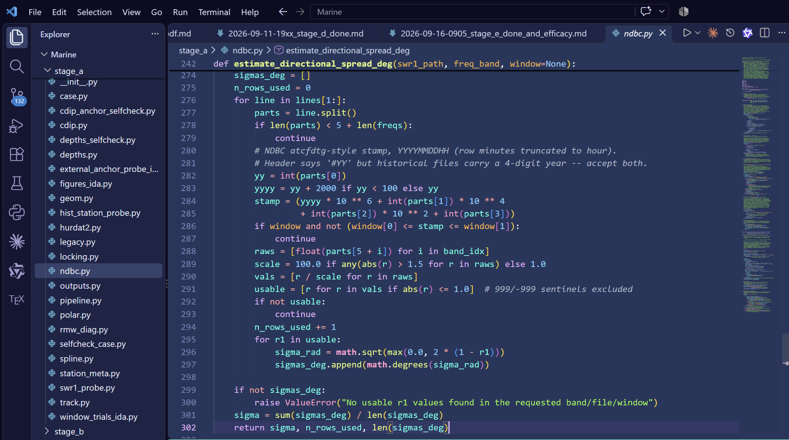

# Amethyst Neon

> A custom dark VS Code theme built on one rule: **one code category, one hue.**
> Nothing shares a color with something it isn't.



## Why it exists

Most themes reuse one accent color across keywords, operators and types, and lean on italics or brightness instead of hue to separate ideas. Amethyst Neon gives every syntactic category its own place on the color wheel, then wraps it in a blue-to-black background that steps darker as you move away from the code — so your eye always knows *which zone* it's in.

- **6-zone background ramp** — title bar to editor, each zone a distinct step of the same blue-violet descent
- **One category, one hue** — operators are the one shade of red you'll ever see in this theme
- **Readable in a dark room** — every token color clears a ≥ 4.0:1 contrast gate against the editor background (checked automatically by script)
- **Comments present, never loud** — soft grey italics: clear when you look, invisible when you don't
- **Semantic highlighting** — bold rose for class/module definitions, distinct treatment for `self`, properties and parameters

## Palette

### Code

| Category | Color | | Category | Color |
|---|---|---|---|---|
| variable | `#3AFCE2` cyan | | string | `#8FF247` green |
| parameter | `#FFB340` amber | | number | `#7DCCFF` blue |
| function | `#E4FA7E` lime | | constant | `#FFA8D0` pink |
| class / module | `#FF9DCA` **bold** rose | | property | `#8CF0D8` seafoam |
| keyword — `if` `for` `return` | `#E5B1FF` lavender | | decorator | `#FF93A9` coral |
| operator — `=` `+` `*` `not` | `#FFA3A3` light red | | comment | `#A9B4C7` *italic* grey |

### Background ramp (dark → darker)

```
editor #23355C  →  sidebar/tabs #1C2348  →  panel/terminal #181B3E  →  activity #141533  →  status #110F2B  →  title bar #0D0A22
```

## Install (from source, no toolchain needed)

1. Clone, or [download the ZIP](https://github.com/PatthamonCharaschimpleekul/amethyst-neon/archive/refs/heads/main.zip)
2. Copy the folder into your extensions directory, renamed:

   ```
   Windows      %USERPROFILE%\.vscode\extensions\saimai.amethyst-neon-0.1.0
   macOS/Linux  ~/.vscode/extensions/saimai.amethyst-neon-0.1.0
   ```

3. `F1 → Developer: Reload Window`
4. `Ctrl+K Ctrl+T` → **Amethyst Neon**

Prefer a package? With Node.js installed:

```bash
npm install -g @vscode/vsce
vsce package            # produces amethyst-neon-0.1.0.vsix
```

Then *Extensions → … → Install from VSIX…*

## Requirements

- VS Code ≥ 1.75
- Full semantic colors in Python work best with Pylance (or any language server emitting semantic tokens); TextMate fallbacks cover everything else

## Tweaking

The whole theme is one JSON file — [`themes/amethyst-neon-color-theme.json`](themes/amethyst-neon-color-theme.json). Change a hex, reload the window. Fork away.

## License

MIT © Patthamon Charaschimpleekul — use it, fork it, tune it.
